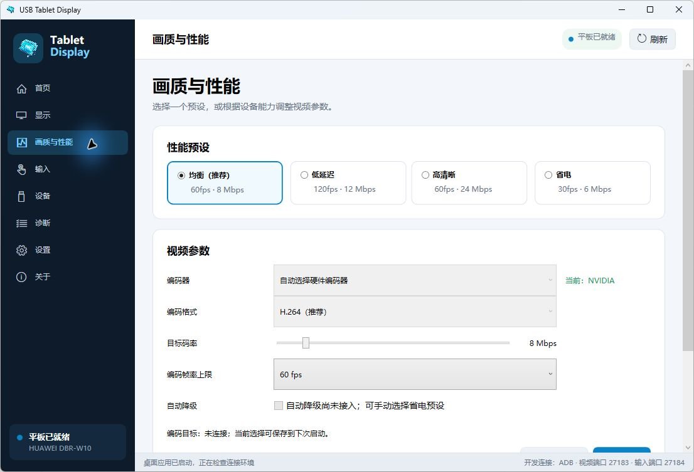
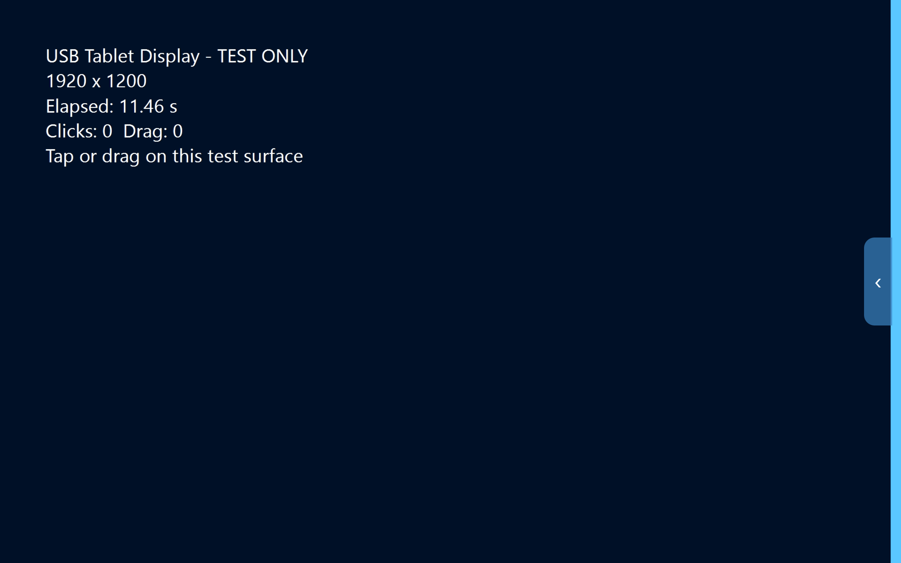
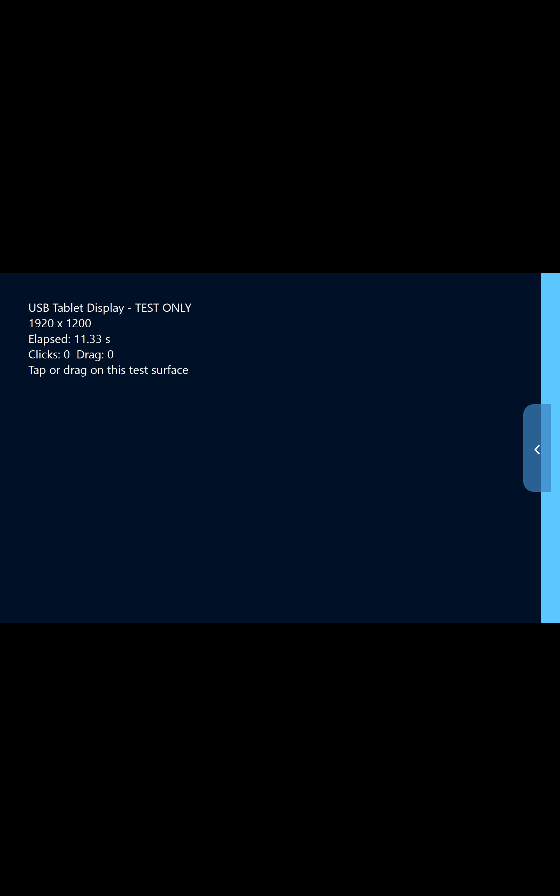

# USB Tablet Display · USB 平板扩展屏

一根 USB 数据线，让 Android 平板成为 Windows 的第二块屏幕。

不是把主屏再复制一遍：你可以在电脑上写代码，在平板上放文档、浏览器或聊天窗口，两块屏幕各做各的事。也可以直接点按、拖拽平板上的 Windows 窗口。

**[下载 v0.2.5](https://github.com/dzdzer327/TabletDisplay-By-USB/releases/tag/v0.2.5)** · [快速上手](#快速上手) · [效果截图](#效果截图) · [反馈问题](https://github.com/dzdzer327/TabletDisplay-By-USB/issues)

## 能做什么

- **真正的扩展桌面**：窗口可以跨屏拖动，屏幕位置、主副屏、缩放与方向通过 Windows 显示设置调整。
- **USB 有线连接**：无需连接 Wi-Fi，电脑端提供启动、停止和连接诊断界面。
- **平板直接操作电脑**：支持原生触控点按、拖拽，以及“仅显示、不接收触控”。
- **按设备调整画质**：支持 720p、1080p、1920×1200、2560×1600，30/60/120fps 编码上限和 2～50 Mbps 码率。
- **硬件视频链路**：Windows 硬件 H.264 编码，Android 硬解；支持 D3D11 零拷贝路径。
- **自动同步平板应用**：首次连接可安装配套 APK，后续按需升级，不必每次重装。

## 效果截图

### 电脑端：在界面中调整画质与帧率

### 平板端：真实 USB 画面传输

下图为华为平板接收 Windows 副屏测试画面的真实截图，不是效果示意图。

横向副屏内容在竖向平板上会等比居中，不拉伸；黑边区域不会误触电脑。

## 下载哪个文件

在 [Releases](https://github.com/dzdzer327/TabletDisplay-By-USB/releases/tag/v0.2.5) 下载：

| 文件 | 用途 |
| --- | --- |
| `TabletDisplay-Windows-x64-v0.2.5-Setup.exe` | **推荐**：Windows 统一安装器，内置 ADB、运行库、显示驱动和配套 APK |
| `TabletDisplay-Android-v0.2.5.apk` | 平板端单独安装或手动更新备用 |
| `TabletDisplay-TestKit-v0.2.5.zip` | 含安装器、APK 和中文教程，适合整包带到另一台电脑 |
| `SHA256SUMS.txt` | 核对下载文件完整性 |

普通使用不需要安装 Visual Studio、WDK、Java 或 Android SDK。不要下载源码 ZIP 来代替安装包。

## 快速上手

### 1. 安装电脑端

双击 Windows 安装器，允许管理员授权，按提示完成安装；如提示重启，先重启。随后打开桌面的 **USB Tablet Display**。

### 2. 连接平板

在平板上开启“开发者选项 → USB 调试”，用支持数据传输的 USB 线连接电脑。在平板弹出的调试授权中，确认是自己的电脑后允许，并保持平板解锁。

### 3. 启动扩展屏

在电脑端点击 **启动扩展屏**。程序会检查、按需安装或更新平板应用，然后打开接收画面。部分平板需要额外确认 USB 安装，请留意平板提示。

### 4. 把窗口拖到平板

打开 Windows **设置 → 系统 → 显示**，选择 **扩展这些显示器**，按真实摆放位置排列两块屏幕。将窗口从相接的屏幕边缘拖过去，就能在两块屏幕上显示不同内容。

应用通常仍在主屏或上次关闭的位置打开，这不代表副屏不能运行应用。也可以用快捷键：

- `Ctrl + Alt + →`：将当前窗口移到平板。
- `Ctrl + Alt + ←`：将当前窗口移回主屏。
- `Ctrl + Alt + Home`：将鼠标召回主屏。

### 5. 调整体验

先使用默认的 **60fps / 8 Mbps**。需要更流畅时，选择 **120fps** 并点击 **应用设置**，程序会同时请求 Windows 副屏 120Hz；画面会短暂重连。停止使用时点击 **停止扩展屏**。

120fps 是实验上限，不是所有设备的保证值。本机短时测试的 Windows 编码采样达到 118～120fps，平板实际呈现还受设备刷新率、解码性能和省电策略影响。

## 使用要求与常见问题

- **设备要求**：Windows 10 22H2 / Windows 11 x64、Android 10+、一根数据线；当前一次连接一台平板。
- **看不到平板**：确认 USB 调试已授权，尝试“文件传输”模式、更换数据线或接口；部分品牌还需要厂商 ADB USB 驱动。
- **平板等待画面**：确认 Windows 已启用扩展显示；尝试在电脑端停止后重新启动连接。
- **鼠标跨屏方向不对**：在 Windows 显示设置中调整屏幕排列，或用上面的召回快捷键。
- **性能不足或画面异常**：先降到 1920×1080 / 60fps，再逐步提高设置。
- **如何卸载**：先停止扩展屏，再到 Windows“已安装的应用”中卸载；平板应用在 Android 上单独卸载。

> 当前为开发预览版：需要 USB 调试与管理员授权，驱动使用项目开发证书，安装器会导入相应证书信任。仅安装你信任的来源。不支持音频、无线连接、软键盘文本回传、HDR 或受保护视频；尚未完成干净电脑与 8 小时稳定性验收。

更详细的 [安装与试用教程](docs/other-pc-quickstart.md)、[版本修复记录](docs/fixes-and-verification-v0.2.5.md) 和 [开发构建说明](docs/development-guide.md) 可在文档中查看。
